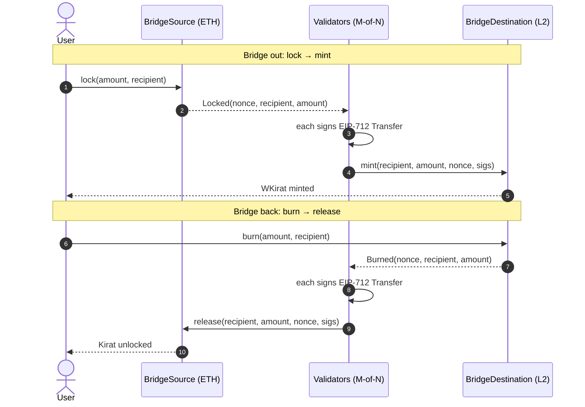

# 🌉 Kirat Token Bridge

**A cross-chain ERC-20 bridge using lock-and-mint and burn-and-release, secured by M-of-N validator signatures.**


**Chains:** Ethereum (home) ⇄ Base · Polygon · Arbitrum (destination)

> ⚠️ Reference implementation. **Not audited.** Do not use with real funds.

---

## 📖 Overview

Tokens can't natively move between blockchains. This bridge lets a token that lives on one chain (**Kirat**, on Ethereum) be used on another (**WKirat**, on Base/Polygon/Arbitrum) without ever creating unbacked supply.

- **Going out:** the original token is **locked** on the home chain and an equal amount of the wrapped token is **minted** on the destination chain.
- **Coming back:** the wrapped token is **burned** on the destination chain and the original is **released** from the lock.

A set of **validators** (the relayers) watch both chains and sign each transfer. The destination contract only acts once enough of them have signed.

```
        HOME CHAIN (ETH)                                  DESTINATION (Base / Polygon / Arb)
 ┌─────────────────────────────┐                        ┌──────────────────────────────────┐
 │ BridgeSource                │                        │ BridgeDestination                │
 │   lock(amount, recipient)   │──── Locked event ─────▶│   mint(to, amount, nonce, sigs)  │
 │   release(..., nonce, sigs) │◀─── Burned event ──────│   burn(amount, recipient)        │
 │ Kirat (ERC-20)              │      ┌───────────┐     │ WrappedKirat / WKIRAT (ERC-20)   │
 └─────────────────────────────┘      │ validators│     └──────────────────────────────────┘
                                      │ (M-of-N)  │
                                      └───────────┘
```

## 🔄 How it works



| Step | Chain | Call | Effect |
|------|-------|------|--------|
| 1 | Home | `BridgeSource.lock(amount, recipient)` | Kirat locked, `Locked(nonce, …)` emitted |
| 2 | Off-chain | validators sign the EIP-712 `Transfer` message | one signature each |
| 3 | Destination | `BridgeDestination.mint(recipient, amount, lockNonce, sigs)` | WKirat minted 1:1 |
| 4 | Destination | `BridgeDestination.burn(amount, recipient)` | WKirat burned, `Burned(nonce, …)` emitted |
| 5 | Off-chain | validators sign again | one signature each |
| 6 | Home | `BridgeSource.release(recipient, amount, burnNonce, sigs)` | Kirat unlocked to `recipient` |

`mint` and `release` can be called by anyone (a relayer or the user). The signatures are the authorization.

**Invariant:** `BridgeSource.totalLocked == WrappedKirat.totalSupply`, and the bridge's Kirat balance is always ≥ `totalLocked`.

## 📜 Smart contracts

| Contract | Chain | Role |
|----------|-------|------|
| [`Kirat.sol`](contracts/Kirat.sol) | Home | Canonical ERC-20 token |
| [`BridgeSource.sol`](contracts/BridgeSource.sol) | Home | Holds locked Kirat. `lock` / `release` |
| [`WrappedKirat.sol`](contracts/WrappedKirat.sol) | Destination | Wrapped ERC-20. Only the bridge can `mint` / `burnFrom` |
| [`BridgeDestination.sol`](contracts/BridgeDestination.sol) | Destination | `mint` / `burn`. Deploys and controls `WrappedKirat` |
| [`BridgeBase.sol`](contracts/BridgeBase.sol) | Both | Shared: validator set, threshold, EIP-712 verification, replay protection, pause, reentrancy guard |
| [`mocks/FeeOnTransferToken.sol`](contracts/mocks/FeeOnTransferToken.sol) | Tests | Fee-on-transfer token to test rejection |

### Inheritance

```
BridgeBase  (Ownable, Pausable, ReentrancyGuard, EIP712)
 ├── BridgeSource        (lock / release)
 └── BridgeDestination   (mint / burn)  ──deploys──▶  WrappedKirat
```

## 🔐 Security design

| Protection | How |
|------------|-----|
| **M-of-N approval** | At least `threshold` distinct validators must sign each transfer |
| **No double-counting** | Signatures must be sorted by ascending signer address; duplicates revert |
| **Domain separation** | EIP-712 digest binds chain id and contract address, so a signature for one bridge can't be replayed on the other |
| **Replay protection** | Each incoming `nonce` is executed once (`processed[nonce]`), set before tokens move |
| **Reentrancy** | `ReentrancyGuard` plus checks-effects-interactions |
| **Safe token handling** | `SafeERC20`; fee-on-transfer tokens rejected on `lock` |
| **Backing guarantee** | `release` can never exceed `totalLocked` |
| **Emergency stop** | Owner can `pause()` / `unpause()` |
| **Access control** | Only the bridge can mint/burn WKirat; only the owner can manage validators |
| **Custom errors** | Cheaper gas and clear revert reasons |

### Trust model and limits (read before mainnet)

- The bridge is only as trustworthy as its validators. If `threshold` or more collude, they can mint unbacked WKirat or drain locked Kirat. Use independent validators and a high threshold.
- The `owner` can add/remove validators, change the threshold and pause. Make the owner a multisig or timelock on a live deployment.
- Validators must wait for enough block confirmations before signing (reorg protection). This repo contains the on-chain contracts and a signing helper, **not** a production validator/relayer service.
- No per-transfer limits or rate limiting yet.
- **Not audited.**

## 🧰 Tech stack

| Layer | Tools |
|-------|-------|
| Smart contracts | Solidity 0.8.24, OpenZeppelin Contracts 5.x (ERC20, Ownable, Pausable, ReentrancyGuard, ECDSA, EIP712, SafeERC20) |
| Dev framework | Hardhat 2, hardhat-toolbox |
| Testing | Mocha, Chai, ethers.js v6, hardhat-network-helpers (`loadFixture`), solidity-coverage |
| Signing | EIP-712 typed data (`signTypedData`) |
| Tooling | Node.js ≥ 18, dotenv, GitHub Actions CI |

## 🚀 Getting started

```bash
git clone https://github.com/swastikjha008-jpg/kirat-token-bridge.git
cd kirat-token-bridge
npm install

npx hardhat compile
npx hardhat test
npx hardhat run scripts/demo.js     # end-to-end lock → mint → burn → release
npm run coverage                    # optional
```

Expected demo output:

```
start                      user Kirat=1000.0  locked=0.0    user WKirat=0.0
after lock                 user Kirat=900.0   locked=100.0  user WKirat=0.0
after mint                 user Kirat=900.0   locked=100.0  user WKirat=100.0
after burn                 user Kirat=900.0   locked=100.0  user WKirat=0.0
after release              user Kirat=1000.0  locked=0.0    user WKirat=0.0
```

## 🌐 Deploy

```bash
cp .env.example .env     # fill PRIVATE_KEY, RPC URLs, VALIDATORS, THRESHOLD

# 1) Home chain (e.g. Sepolia). REMOTE_CHAIN_ID = destination chain id (Base Sepolia = 84532)
REMOTE_CHAIN_ID=84532 npx hardhat run scripts/deploySource.js --network sepolia

# 2) Destination chain. REMOTE_CHAIN_ID = home chain id (Sepolia = 11155111)
REMOTE_CHAIN_ID=11155111 npx hardhat run scripts/deployDestination.js --network baseSepolia
```

Addresses are written to `deployments/<network>-{source,destination}.json` (git-ignored). Networks appear in `hardhat.config.js` when their RPC variable is set: `sepolia`, `baseSepolia`, `polygonAmoy`, `arbitrumSepolia`.

| Env var | Meaning |
|---------|---------|
| `VALIDATORS` | Comma-separated validator addresses |
| `THRESHOLD` | Signatures required (default: simple majority) |
| `REMOTE_CHAIN_ID` | Chain id of the *other* chain |
| `KIRAT_ADDRESS` | Existing ERC-20 to bridge (optional, otherwise a new Kirat is deployed) |
| `INITIAL_SUPPLY` | Supply in whole tokens when deploying a new Kirat |

## ✍️ Validator signing

```js
const { signTransfer } = require("./scripts/lib/signing");

// After a Locked event on the home chain, authorise the mint on the destination:
const sigs = await signTransfer([v1, v2, v3], destinationBridge, recipient, amount, lockNonce);
await destinationBridge.mint(recipient, amount, lockNonce, sigs);
```

`signTransfer` returns signatures already sorted the way the contracts require.

## 🧪 Tests

33 tests, 100% line coverage. They cover:

- lock / mint / burn / release happy paths and the full round trip
- replay attempts, too few signatures, duplicate and unsorted signatures
- signatures from non-validators and tampered amount / recipient / nonce
- cross-bridge signature replay
- pause, admin access control, validator add/remove and threshold rules
- the locked == wrapped supply invariant
- fee-on-transfer token rejection

## 📁 Project layout

```
contracts/   Solidity sources (+ mocks/)
test/        Hardhat tests
scripts/     deploySource.js, deployDestination.js, demo.js, lib/ (signing, config)
.github/     CI workflow
```

## 🗺️ Roadmap

- [ ] Validator / relayer service that watches events and signs
- [ ] Per-transfer and daily limits
- [ ] Timelock / multisig ownership
- [ ] Support for multiple tokens and chains
- [ ] Professional audit

## 📄 License

MIT
